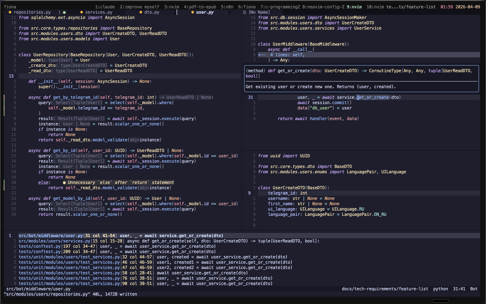

# nvim

Personal Neovim configuration. Minimal, hand-picked, no distro.

Rewritten from scratch for Neovim 0.11+: native LSP API (`vim.lsp.config` / `vim.lsp.enable`), `nvim-treesitter` on `main`, no mason. Cold start ~30–50 ms.



## Stack

| Area            | Plugin                                              |
| --------------- | --------------------------------------------------- |
| Plugin manager  | `lazy.nvim`                                         |
| Colorscheme     | `catppuccin`                                        |
| Completion      | `blink.cmp` (Rust core)                             |
| Fuzzy finder    | `fzf-lua`                                           |
| File explorer   | `oil.nvim` (floating) + built-in `netrw`            |
| Treesitter      | `nvim-treesitter` (`main` branch, local compile)    |
| Text objects    | `mini.ai` + `nvim-treesitter-textobjects`           |
| Formatting      | `conform.nvim`                                      |
| Git             | `gitsigns.nvim`                                     |
| Buffers         | `bufferline.nvim`                                   |
| AI              | `codeium.vim` (Windsurf)                            |
| Cursor FX       | `smear-cursor.nvim`                                 |

Statusline is a one-liner in `lua/options.lua` — no `lualine`.

## Layout

```
init.lua              — strict boot order (options → keymaps → lazy → lsp)
lua/options.lua       — vim.opt + custom statusline
lua/keymaps.lua       — global mappings (leader is ;)
lua/lazy-bootstrap.lua
lua/lsp.lua           — 0.11 native LSP config + LspAttach keymaps
lua/plugins/*.lua     — one file per plugin
```

## Conventions

- `<leader>` is `;`
- Insert-mode escape is `jj`
- LSP binaries, formatters and the `tree-sitter` CLI are installed out-of-band (brew / npm / pipx) — no mason

See [CLAUDE.md](./CLAUDE.md) for the full architecture notes, boot sequence, and rationale behind what is *not* in this config.

## License

[MIT](./LICENSE)
